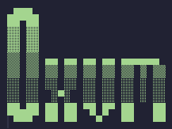

# 0xvm

> A small, standalone C stack VM.
> Originally used by a process migration experiment for my PhD research.



The machine is frozen at ABI v2: 64-bit cells, 64 KiB byte-addressed RAM,
16-bit addresses, byte-encoded instructions, `VMIM` v2 ROMs, and a device page
for all I/O.

## Build

```sh
make all              # build lib0xvm, the 0x* tools, hosts, tests, conformance ROM
make test             # run 0xtest, conformance, Snake, and typography checks
make conformance      # write build/conformance-v2.rom
make conformance-check # run that ROM through 0xvm and diff the golden transcript
make sdl              # build 0xvm-sdl (skipped when SDL3 is unavailable)
make sdl-check        # run the conformance ROM through 0xvm-sdl with dummy video
make wasm             # build the browser host (skipped when emcc is unavailable)
make wasm-check       # smoke-run Snake through the browser host under Node
make bench            # run repeatable benchmarks to build/bench/last.json
make bench-compare    # compare a fresh run with the committed baseline
make lua-check        # compile and run the Lua-subset smoke program
make luac-install     # install the 0xluac CLI in editable mode
```

`make all` produces `build/lib0xvm.a` and `build/lib0xvm.so`, six tools
(`0xvm`, `0xasm`, `0xdis`, `0xrom`, `0xdb`, `0xtest`), and — when
`pkg-config sdl3` succeeds — `build/0xvm-sdl`. When `emcc` is available, it also
produces `build/0xvm-wasm.js`, `build/0xvm-wasm.wasm`, and a ready-to-serve
`build/0xvm-wasm.html`. The CLI tools accept `-f/--file`, `-v/--version`, and
`-h/--help`; `0xtest` accepts `-v` and `-h`.

To run Snake in a browser:

```sh
make wasm
python3 -m http.server 8000 --directory build
# open http://localhost:8000/0xvm-wasm.html
```

The page loads `snake.rom` by default, accepts `?rom=URL` to load a shared ROM
(for example `?rom=typography.rom`), and the file picker loads any VMIM v2 ROM.
Arrow keys, space, enter, and escape map to the portable Controller codes, and
Console text appears beside the canvas.

| Tool | Purpose |
| --- | --- |
| `0xvm` | CLI host: run a source file or ROM; `-t` traces, `-D` prefixes output with ticks |
| `0xvm-sdl` | SDL3 host: Screen, Controller, and timer devices; `-W`/`-H` set the framebuffer size |
| `0xvm-wasm` | browser host: canvas Screen, keyboard Controller, and timer devices |
| `0xasm` | assemble source into a VMIM ROM; `-o` sets the output path, `-I` adds include paths |
| `0xdis` | disassemble a source file or ROM |
| `0xrom` | inspect and validate a ROM header |
| `0xdb` | interactive debugger: breakpoints, stepping, stack/RAM/frame dumps |

Host sources live under `hosts/`; tools and shared helpers stay under `apps/`.
See `hosts/README.md` for host-specific build and run notes.

```sh
./build/0xvm -f examples/counter.asm
./build/0xvm -t -f examples/gcd.asm
./build/0xasm -f examples/counter.asm -o counter.rom
./build/0xrom -f counter.rom
./build/0xdis -f counter.rom
./build/0xvm-sdl -f paint.asm -W 640 -H 480   # needs SDL3
./build/0xdb -f examples/gcd.asm              # interactive debugger
```

## Debugging

`0xdb` runs the same VM core with a terminal command loop. Source files provide
labels, constants, and source-line mapping; ROMs work too, with `-s SOURCE` to
attach labels and line numbers from the matching assembly file.

```sh
./build/0xdb -f examples/gcd.asm
./build/0xdb -f build/gcd.rom -s examples/gcd.asm
printf '5\n10\n20\n30\n40\n50\n1\n' > stats.in
./build/0xdb -f examples/statistics.asm -i stats.in
./build/0xdb -f examples/gcd.asm -x tests/debugger.in   # scripted session
```

Common commands:

| Command | Meaning |
| --- | --- |
| `c`, `s [N]`, `n`, `finish`, `until ADDR` | continue, step, step over `CALL`, return, run to address |
| `b ADDR\|LABEL\|LINE`, `d N\|all`, `enable`/`disable` | breakpoints (`*ADDR` forces an address) |
| `info`, `stack [N]`, `locals [N]`, `frames`, `heap` | machine state and call frames |
| `x[/8\|/16\|/32\|/64] ADDR [N]`, `dis [ADDR] [N]`, `list [LINE]` | RAM, disassembly, source |
| `symbols [FILTER]`, `reset`, `q` | symbols, reload image, exit |

Addresses may be `0x...`, a label, `$` (current `ip`), or `label+offset`. Console
input is read from `-i FILE` (or `/dev/null`) so it never competes with debugger
commands. `make debugger-check` runs the scripted golden session in
`tests/debugger.in`.

The conformance image is a real ROM, not just a C test. It exercises every
opcode and the full System/Console device set, then halts through `VM_SYS_HALT`.
The CLI host must produce `tests/conformance.expected` from this scripted input:

```sh
printf 'B-7\nhey\n' | ./build/0xvm -f build/conformance-v2.rom
```

`make test` checks the same ROM through a fresh scripted host and runs the CLI
diff automatically.

## Lua-subset compiler

The `luac/` package is an early compiler that emits `0xasm` text rather than a
ROM, so the assembler still supplies labels and line mapping to `0xdb`. The
supported subset covers integer literals, string literals passed to `print`,
locals and assignment, arithmetic and comparisons, `if`/`else`, `while`,
numeric `for` loops, functions with parameters/returns/recursion, static
byte/word arrays with indexing, and typed heap allocations with pointer offsets.
The roadmap for reaching a typography-level demo is in
[`docs/Compiler-Design.md`](docs/Compiler-Design.md).

Run it directly from the repository without installing anything:

```sh
python3 -m luac compile tests/lua/smoke.lua -o build/smoke.asm
./build/0xasm -f build/smoke.asm -o build/smoke.rom
./build/0xvm -f build/smoke.rom
make lua-check    # front-end unit tests plus the golden program above
```

The package can also be installed as the `0xluac` command. The name avoids a
collision with the `luac` compiler shipped with Lua:

```sh
pip3 install -e .
0xluac compile tests/lua/smoke.lua -o build/smoke.asm
```

For a non-editable install, run `pip3 install .` instead, or use
`make luac-install` for the editable form.

Strings are static `(addr, length)` buffers; numbers, function results, and heap
addresses are signed 64-bit cells. Tables, device I/O, and source-level line
remapping are not implemented yet.

## Performance baselines

The latest benchmark and profiling results are committed under `bench/` so
there is always a reference point for comparing changes:

- `bench/baseline.json` — benchmark medians and samples from `scripts/bench.py`.
- `bench/perf-profile.txt` — instruction profile from the CLI `-p` run.

`make bench` writes a fresh report to `build/bench/last.json`. After an
intentional performance change, promote the fresh results to the committed
baselines:

```sh
make bench-update
make perf-update
```

To compare current results with the committed baselines:

```sh
make bench-compare                 # fails on >25% median MIPS regression
make bench-compare THRESHOLD=0.10  # stricter threshold
make perf-compare                  # diffs the current instruction profile
```

`make bench-compare` runs 20 samples first and compares against
`bench/baseline.json` by default. Wall-clock results include process startup and
vary between machines, so `THRESHOLD` is deliberately permissive; tune it for
your environment. Override `BASELINE=...` and `CURRENT=...` to compare arbitrary
JSON reports.

## Assembly quick reference

- One instruction per line; mnemonics are case-insensitive.
- `name:` labels are absolute 16-bit byte addresses and may share a line with
  an instruction or data directive.
- Comments start with `;`, `#`, or `//` and are ignored inside quoted strings.
- Operands are integer expressions: decimal, `0x` hex, constants from
  `EQU name expr`, and the usual arithmetic, bitwise, and comparison operators.
  `PUSHF` takes a floating-point literal.
- Data directives: `DB`, `DW`, `DQ`, `STR`, `ALIGN`. Data lives in the image
  area and is directly addressable with `LOAD*`/`STORE*`.

```asm
INCLUDE "all.asm"      ; opt in to the stdlib macros
EQU N 4
PUSH N*2
PRINT
HALT
```

Source-level directives (no VM or ROM changes):

| Directive | Meaning |
| --- | --- |
| `INCLUDE "path"` | insert a file; search the including file's directory, `-I DIR` paths, then `stdlib/` |
| `IF` / `IFDEF` / `IFNDEF` | conditional assembly; use `ELIF`, `ELSE`, `ENDIF` |
| `MACRO name p1, ...` / `ENDMACRO` | reusable body; `ENDM` is an alias |

Macro parameters are `%1`, `%2`, ... or `%p1`, `%p2`, ...; `%%` expands to a
unique prefix for macro-local labels. Conditions see constants and defined
names only.

There are no built-in pseudo-ops: readable names are opt-in macros from
`stdlib/`. `INCLUDE "all.asm"` pulls in everything, or include an individual
module:

| Module | Provides |
| --- | --- |
| `arith.asm` | `INC`, `DEC`, comparisons, shifts |
| `locals.asm` | `ENTER`, `LEAVE`, `LOCAL_GET/SET` |
| `console.asm` | `PRINT_CHAR`, `PRINT`, `FPRINT`, `READ_INT`, `PRINT_STR`, `READ_STR` |
| `ports.asm` | `CONSOLE_*`, `SCREEN_*`, `CONTROLLER_*`, `TIMER_*` port constants |
| `screen.asm` | `SCREEN_SIZE`, `SET_COLOR`, `PLOT_XY`, `PLOT`, `DRAW`, `CLEAR` |
| `controller.asm` | `READ_KEY`, `QUIT_REQUESTED` |
| `timer.asm` | `NOW_MS` |
| `mem.asm` | `MEMCPY`, `MEMSET`, `MEMZERO`, `MEMCMP` |
| `strings.asm` | `STRCPY`, `STRCMP`, `STREQUAL`, `STRCAT`, `STRSLICE`, `STRFIND`, `STRCHR`, `STRLENZ` |
| `alloc.asm` | `ALLOC_ZERO`, `ALLOC_ARRAY`, `FREE_PTR`, `ARENA_INIT/ALLOC/FREE` |
| `util.asm` | `MIN`, `MAX`, `CLAMP`, `ABS`, `ALIGN8`, bit helpers, `RNG_SEED/NEXT` |
| `collections.asm` | `VEC_*`, `MAP_*` over an arena |

Strings are explicit `(addr, len)` byte buffers. `STRFIND` and `STRCHR` return
an index or `-1`; an empty needle returns `0`. `STRCMP` returns `-1`, `0`, or
`1`. The map uses a 64-bit integer key and reserves `0` for empty slots.

The core assembler knows only real opcodes and directives, so any stdlib macro
can be replaced by a user definition. `0xasm -I DIR` adds extra include
directories. With `-t`, macro-generated bytes report their invocation line.

## Examples

- `examples/counter.asm` — a simple loop.
- `examples/features.asm` — data, procedures, floats, and Console I/O.
- `examples/asm_ext/main.asm` — includes, conditionals, and macros.
- `examples/statistics.asm` — a larger heap-based tool.
- `examples/paint.asm` — interactive Screen/Controller/timer demo for `0xvm-sdl`.
- `examples/snake.asm` — the flagship game: arena-backed body, RNG food, and a
  string score. It ends on collision, escape, or after 20 apples. Run it with
  `./build/0xvm-sdl -f examples/snake.asm` or in the browser host above.
- `examples/typography.asm` — a graphical 5x7 bitmap-font text editor: arrows
  move the caret, printable keys insert at the caret, enter adds a newline, and
  escape exits. It is an example app, not a stdlib module. Run it with
  `./build/0xvm-sdl -f examples/typography.asm` or `?rom=typography.rom` in the
  browser host.

```sh
./build/0xvm -f examples/features.asm
./build/0xvm -f examples/asm_ext/main.asm
printf '5\n10\n20\n30\n40\n50\n1\n' | ./build/0xvm -f examples/statistics.asm
./build/0xvm-sdl -f examples/paint.asm        # requires SDL3
./build/0xvm-sdl -f examples/typography.asm   # requires SDL3
```

`paint.asm` and `typography.asm` use the optional Screen, Controller, and
timer ports, so they need `0xvm-sdl`; `0xvm` only provides System and Console.
Arrows move the brush in `paint.asm`, space toggles painting, enter cycles
colours, `c` clears, and escape or a window close exits. In `typography.asm`,
arrows move the caret, printable ASCII inserts text, enter adds a newline, and
escape or a window close exits. Use `SDL_VIDEODRIVER=dummy` for a headless run.

## Documentation

- [VM Implementation](docs/VM-Implementation.md) — instruction semantics,
  assembler details, execution rules, and error atomicity.
- [Machine Contract](docs/Machine-Contract.md) — frozen ABI, memory map,
  instruction encodings, ROM format, and devices.
