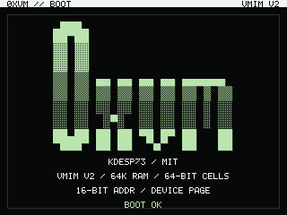

# 0xvm

> A small, standalone C stack VM.



## Build

```sh
make help          # list available targets
make all           # build everything available on this machine
```

Optional SDL3 and browser hosts are built when their toolchains are installed.

## Run

```sh
./build/0xvm -f examples/counter.asm
./build/0xvm -t -f examples/gcd.asm
```

Assemble and inspect a ROM:

```sh
./build/0xasm -f examples/counter.asm -o build/counter.rom
./build/0xrom -f build/counter.rom
./build/0xdis -f build/counter.rom
```

Run a graphical example:

```sh
make sdl
./build/0xvm-sdl -f examples/snake.asm
./build/0xvm-sdl -f examples/paint.asm
./build/0xvm-sdl -f examples/typography.asm
```

## Browser

```sh
make wasm
python3 -m http.server 8000 --directory build
```

Open <http://localhost:8000/0xvm-wasm.html>. The page starts with `boot.rom`.
Use Run/Pause, Restart, load file, the four screen-size presets, and the
console panel. Arrow keys, space, enter, and escape control programs.

## Debug

```sh
./build/0xdb -f examples/gcd.asm
```

Type `help` inside the debugger for commands.

## Lua compiler

```sh
make lua-check
python3 -m luac compile examples/typography.lua -o build/lua-typography.asm -m build/lua-typography.lumap
./build/0xasm -f build/lua-typography.asm -o build/lua-typography.rom
./build/0xvm-sdl -f build/lua-typography.rom
```

## Checks

```sh
make test
make conformance-check
make sdl-check
make wasm-check
make boot-check
make lua-check
```

## Benchmarks

```sh
make bench
make bench-compare
```

## More information

- [Host notes](hosts/README.md)
- [Design language](docs/Design-Language.md)
- [Machine contract](docs/Machine-Contract.md)
- [VM implementation](docs/VM-Implementation.md)
- [Compiler design](docs/Compiler-Design.md)
- [Roadmap](docs/Roadmap.md)
